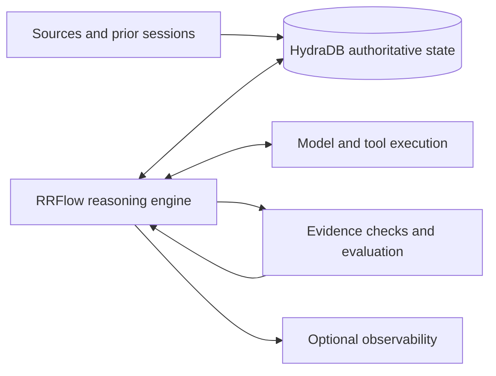

# Applying the RRFlow research

Current authority: the user's shippin.cloud direction makes **RRFlow the reasoning engine and HydraDB the authoritative persistent state system**. The [connectome brief](SHIPPIN_CONNECTOME.md) records this. Internal drafts supply reusable concepts; their former component/storage assignments are historical.

The deeper pass also inspected the September 26 engine plan and September 30 question bank. They add concrete scoring and evidence-binding proposals without establishing a replacement for v3's role assignments. [Analysis and counterexamples](DEEP_RESEARCH.md)

## Historical draft responsibilities

The [v3 notes](https://docs.google.com/document/d/1NCIJK8wBlnzAa43OuWLktQup3RtksqDvM8n2ckPWj5U/edit) previously assigned:

- **LFG:** deterministic intent classification; emits an address and recipe, with an extension path for uncertain cases.
- **Governance:** permission and verification checks, including verification of recalled context.
- **RRFlow:** persistent trees, revisions, rules, exemplars, journal, verdicts, outcomes, and boundary documents, behind a store trait.
- **Snapshot compiler and promotion:** offline processes that build LFG snapshots and move candidate rules toward activation.
- **Clyffy:** the agent loop and orchestration.
- **Dalal:** provider/model gateway and dispatch.

The notes identify five operations: Gate, Choice, Score, Extract, Compose. Their deterministic kernel is separated from similarity/model extensions. Classification is a suggestion with provenance and can be overridden.

Corrections worth retaining in the research base:

| Earlier description | September 26 correction |
| --- | --- |
| Judge is LFG's second mode | Verification belongs to Governance |
| Three answer types | Five operations |
| Address hash includes revision | Proposed hash derives from path, excluding revision |
| Memory-mapped snapshot | Heap-loaded snapshot for the planned swap model |
| First journal must use rrd-lsm | Flat journal behind a trait |
| Passing storage tests show the system works | Cited tests were unit-only, not end-to-end evidence |

The older local RRO manifesto provides historical context about governed retrieval, but its Qdrant/tri-database/GPU strategy should not silently override v3. The ArkType project README points to a separate validation-authoring workstream. Neither is evidence that the proposed HydraDB integration exists.

## Concepts with a strong fit

| Existing concept | Proposed application with HydraDB | Proof we would need |
| --- | --- | --- |
| Stable addresses and revisions | Anchor requests, evidence, rules, and outcomes to a category path and explicit revision | Replay returns the intended revision; alias changes do not corrupt history |
| Bounded context per reasoning step | Retrieve a small graph neighborhood for the current address and task | Relevant evidence fits the budget and excludes unrelated material |
| Separate Governance | Check provenance, scope, freshness, and sufficiency before retrieved content enters the agent context | Unsupported or stale evidence is rejected with an inspectable reason |
| Journaled overrides | Connect an incorrect classification to its correction, supporting sources, and later outcomes | The correction changes a repeat case without breaking held-out cases |
| Slow path produces candidate rules | Persist extension answers as inactive candidates; evaluate before snapshot compilation | Higher deterministic coverage without more wrong confident answers |
| Bitemporal intent | Preserve both effective history and the time a correction became known | Distinct answers to “true then” and “known then” questions |
| Proof artifacts | Store links from rule revision to fixtures, checks, verdicts, and deployment | Every active revision can be traced to its evidence |

The user has now explicitly selected HydraDB for authoritative state and RRFlow for reasoning. V3's Postgres/store-trait proposal is not the shippin.cloud architecture. Adapt its useful rule, revision, evidence, and promotion concepts directly to HydraDB.

## An evidence graph to investigate

Proposed node types: `SourceVersion`, `Claim`, `Category`, `RuleVersion`, `Decision`, `Correction`, `Verification`, `Outcome`.

Proposed relationships: `SUPPORTED_BY`, `CLASSIFIED_AS`, `USED_RULE`, `RETRIEVED`, `CORRECTS`, `SUPERSEDES`, `VERIFIED_BY`, `RESULTED_IN`.

Store original evidence references alongside any extracted claim. A relation inferred by a model remains an inference until an appropriate check validates it. Keep canonical IDs and revisions intact; a 64-bit join key needs collision handling if used as authoritative identity.

This diagram follows the user's current direction. Reasoning records, knowledge, rules, corrections, and active revisions belong to HydraDB. Evaluation is behavior within the RRFlow system; an optional observability product does not own persistent reasoning state.

## A real example from this research

The September 25 notes placed Judge in LFG. The September 26 notes explicitly moved verification to Governance. A useful memory system should answer both:

- “Where does verification belong now?” — Governance, according to v3.
- “What did the previous design propose?” — LFG's Judge mode, according to v2.

It should retain the supersession evidence, distinguish a draft from a ratified decision, and avoid blending both into a nonexistent hybrid architecture. This gives us a concrete example of the value of temporal and provenance-aware retrieval.

## Candidate directions for later brainstorming

1. **Memory that explains corrections.** Demonstrate changing facts, superseded decisions, and justified abstention. Strongest direct overlap with the v3 research and the published memory track.
2. **A failure-to-rule improvement loop.** Link a Raindrop failure to the context and rule used, evaluate a proposed correction, then compare the next revision. Strongest integration story for all three systems.
3. **Code context shaped by project decisions.** Connect code, tests, dependencies, and architectural constraints. Requires a reliable code ingestion path; the older RRO work supplies motivation, not a ready integration.

These are hypotheses to compare after the capability checks. Their novelty and measured benefit have not been established.
