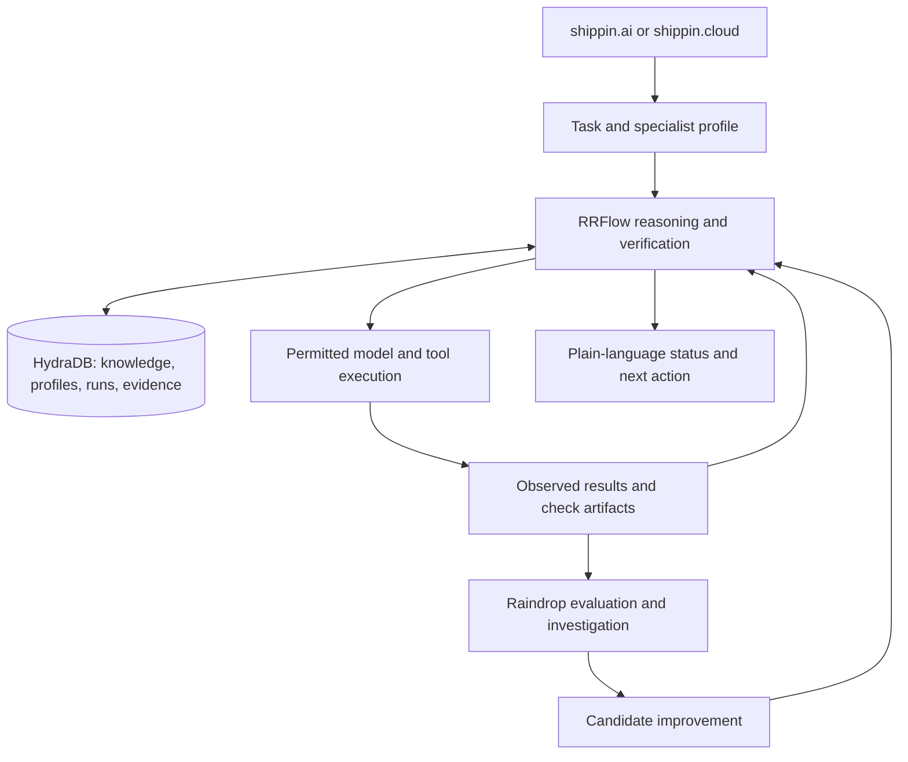

# RRFLOW: a configurable engineering specialist

Updated October 12, 2026. User direction and proposed design; no specialist runtime is implemented by this document.

## Product purpose

RRFLOW should bring the working discipline of a methodical senior developer to overseeing AI development and operations. Jesse wants it to understand the project, investigate before acting, make dependencies visible, verify the result, and retain lessons. It should integrate as a configurable dedicated specialist for shippin.ai and shippin.cloud, with a strong interface that people can understand without engineering expertise.

The existing launch/infrastructure use case remains the first proving ground: shippin.cloud, shippin.ai, shipping.buzz, the tailnet, Cisco servers, Proxmox instances, and the homelab. This adds supervision of the work performed against that context. [Working checklist](../WORKPLAN.md)

“Never takes shortcuts” becomes an enforceable requirement where possible: a required verification cannot be skipped or replaced by the worker's claim that it passed. Architecture choices and ambiguous evidence still require judgment whose quality must be evaluated. Neither a model persona nor a passing check guarantees that all defects are absent.

## What the specialist does

| Working habit | Concrete behavior | Evidence |
| --- | --- | --- |
| Understand before changing | Load the task, current project instructions, relevant code/infrastructure, constraints, and prior decisions | Referenced sources and revisions; explicit unknowns |
| Plan proportionately | Identify affected components, select the smallest justified change, and define how success will be checked | Task plan and applicable verification policy |
| Investigate uncertain facts | Open relevant knowledge avenues and compare conflicting observations | Supporting source, freshness, and reason for the chosen interpretation |
| Supervise execution | Validate intended tool actions and follow actual results; revise the plan when evidence changes | Recorded targets, arguments, tool outcomes, and state transitions |
| Review the change | Check contracts, dependencies, failure behavior, and whether the user outcome was achieved | Concrete findings bound to the exact changed revision |
| Verify completion | Evaluate required checks from their execution results and inspect the resulting behavior | Runner/CI artifacts, Playwright results, revision, and environment |
| Learn deliberately | Propose prompt or rule changes from observed failures and evaluate them before activation | Baseline/candidate comparison, held-out cases, promotion or rejection, rollback |

Methodical work includes choosing checks appropriate to the change. Repeating passing tests without a reason, building unused abstractions, or asking for routine approvals does not improve oversight. Applicable checks should be selected by explicit policy and impact, not by the worker's wish to mark a task done.

## Configurable specialist profile

Profiles are versioned records in HydraDB. Each run pins the effective profile and prompt versions so later configuration changes do not rewrite its history.

| Setting | Plain-language purpose |
| --- | --- |
| Responsibility | What this specialist is responsible for, such as reviewing a service change or diagnosing a launch blocker |
| Project and service scope | Which repositories, services, environments, and infrastructure it may work with |
| Knowledge scope | Which HydraDB sources and avenues it may retrieve, with freshness requirements |
| Working standards | Applicable project conventions, acceptance criteria, and required checks |
| Available actions | Tools, allowed targets, read/write boundaries, and existing authorization |
| Judgment settings | Model/prompt version, uncertainty handling, and escalation conditions |
| Execution limits | Time, retrieval, tool-call, and cost budgets |
| Completion policy | Evidence needed for the specific task to become verified; explicit treatment of exceptions |
| Improvement policy | Evaluation cases and conditions for proposing, activating, or rolling back a revision |

Configuration is constrained by the caller's authenticated permissions and deployment policy. A supplied profile ID cannot grant access to another project. Prompt edits and ordinary task execution cannot silently relax required checks or enlarge tool permissions. Existing authorization should be reused within its scope; ask for input when a real missing decision or authorization blocks the work.

## Technical integration approach

Both products can invoke the same RRFlow task/decision functions with a specialist profile binding. A server-side HTTP interface can expose these functions; an MCP interface can expose task-level operations when agent clients need them. These are proposed interfaces, not existing endpoints or vendor tools.

Examples of useful domain operations are starting a scoped task, assessing a proposed action, submitting execution evidence, reviewing a change, and evaluating completion. They provide reasoning and verification behavior. HydraDB retrieval, ingestion, graph, and inspection operations should still use native interfaces directly, not pass through renamed duplicate APIs. HydraDB publishes [official Python and TypeScript clients](https://docs.hydradb.com/api-reference/v2/sdks).

This diagram describes logical responsibilities, not separate databases or a required fleet of services. Client UI state can be transient; durable task/profile/decision state belongs to HydraDB. Credentials stay server-side in Infisical. Native infrastructure systems provide live observations.

Enforcement requires control over the relevant execution and completion paths. If a worker can directly deploy with separate credentials, overwrite verification records, or mark completion outside RRFlow, the specialist is advisory for those actions. Verify those boundaries before describing it as an enforcing supervisor.

## Evidence and completion contract

Record the evidence producer, task/check ID, source or code revision, input versions, execution environment, command/tool identity, timestamps, result, and artifact reference. Bind evidence to the exact checked content, including a content digest when the working tree has uncommitted changes. The worker's supplied ID or success text is not sufficient validation.

Use `pass`, `fail`, `unknown`, and `not applicable` for checks. Display task progress in plain language such as **Understanding the task**, **Working**, **Checking the result**, **Needs attention**, and **Verified**. Keep detailed check outcomes available under those summaries.

Before a protected transition, revalidate that the evidence still applies to the current task, revision, target, and policy. Any required failed or unknown check prevents a verified completion result. An authorized exception records its reason and scope and remains visible as an exception, rather than becoming a fabricated pass. Runtime authorization and concurrent state updates need proof on the selected HydraDB surface; this design does not assume transaction features that have not been verified.

Model review can supplement deterministic checks. Keep its findings and confidence distinct from executed tests; another model reading the same incomplete context is not independent proof.

## UI for people without engineering expertise

The main task view should answer:

1. **What are we trying to do?** Show the service, goal, and affected area.
2. **What is happening now?** Show real progress and the next useful step.
3. **What did we check?** Explain outcomes and let the user open the supporting evidence.
4. **What needs attention?** Explain a blocker, its consequence, and the available action.
5. **What changed?** Show the result, verification status, and any remaining limitation.

Example: “The server is reachable, but the application check failed. We need to inspect the latest deployment.” The evidence drawer can then expose the timestamp, source, relevant logs, and check result. Do not show a green “ready” label merely because one lower-level check succeeded.

Configure specialists through concrete fields such as **Responsible for**, **Can access**, **Can do**, and **Checks before finishing**. Explain their effect in ordinary language. Advanced model, query, and transport details belong in a secondary view. Give users a way to understand why a knowledge avenue was opened without displaying invented internal reasoning.

## First supervision demonstration

Use an explicitly labeled test fixture or controlled service change where an AI worker claims a task is complete while a required check is absent or belongs to an older revision. RRFlow should show **Needs attention**, explain the missing evidence, run or request the applicable check within its authority, and accept only valid results. Save and reload the resulting decision through HydraDB.

Then test a valid change, an irrelevant check correctly marked not applicable, a direct bypass attempt, a conflicting source, and a prompt edit attempting to weaken policy. Measure false blocks as well as missed failures, time to completion, and cost. The aim is dependable oversight with proportionate work.

Raindrop's [replay and playground](https://raindrop.ai/docs/sdk/custom-replay-endpoint.md) can support evaluating candidate prompt parameters through the real agent harness. Active production revisions and policy decisions remain in HydraDB; native prompt serving and automatic deployment have not been established. Test execution must not replay production infrastructure mutations.

Implementation and evidence requirements are tracked by checklist items E7–E10, F10, and H8 in [WORKPLAN.md](../WORKPLAN.md).
