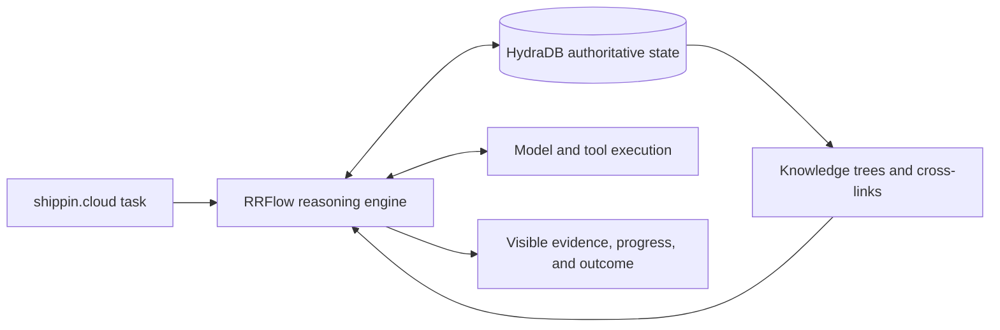

# RRFLOW: HydraDB-native reasoning connectome

October 12, 2026. This document records the user's current direction and the research implications. It takes precedence over earlier proposals in this research pack. It is not a claim that these behaviors are implemented.

## Confirmed product direction

- **RRFLOW** is the configurable engineering specialist product direction, integrating with **shippin.ai** and **shippin.cloud**.
- Jesse is the first operator, launching and managing **shippin.cloud, shippin.ai, and shipping.buzz**.
- The UI should populate from the tailnet and expose infrastructure drill-down across Cisco servers, Proxmox instances labeled WI / TX / VA, and the homelab. Raindrop should support system-prompt improvement over time. Actual topology and integrations remain unverified.
- **RRFlow is the reasoning engine**. Its job is to select, traverse, apply, verify, and improve knowledge during inference.
- **HydraDB owns the authoritative persistent state**: knowledge, relationships, reasoning records, rules, revisions, outcomes, and corrections.
- Knowledge trees and cross-linked avenues become available as a task unfolds.
- Adapt the RRFlow research to HydraDB's products and native capabilities. Avoid parallel state stores and abstractions that merely rename vendor operations.
- Codex and the existing Claude instance are to collaborate as one team with clear ownership and one coherent experience.
- The specialist should apply methodical engineering practice to AI oversight, with evidence for required checks and a UI understandable without engineering expertise. [Specialist design](RRFLOW_SPECIALIST.md)

The older drafts' assignments of RRFlow to a storage role, Postgres to persistence, and other components to orchestration are historical inputs. They do not override these decisions.

Execution objectives and acceptance checks are in [WORKPLAN.md](../WORKPLAN.md). [Infrastructure and prompt research](INFRASTRUCTURE_OPERATIONS.md) grounds the selected operator use case in native product capabilities.

## The reasoning behavior to investigate

Working interpretation of “during inference”: RRFlow makes knowledge available between observable model/tool steps. Retrieval supplies context to subsequent model calls. This does not assume access to a model's internal activations.

1. **Locate:** resolve the task, project, relevant entities, and candidate knowledge branches. Preserve multiple candidates when classification is uncertain.
2. **Expose:** provide a small set of eligible avenues with concise descriptions and evidence references.
3. **Traverse:** choose an avenue based on what the current step needs, then use HydraDB's native retrieval or graph operations to expand it.
4. **Ground:** load the source evidence needed for a decision; bind predicates to exact source and rule revisions.
5. **Act and observe:** run the model/tool step, record the result, and decide whether to expand, reconsider, verify, or finish.
6. **Retain:** persist the run's meaningful state and evaluated corrections in HydraDB.

RRFlow's contribution is the decision process: when an avenue is relevant, whether evidence is sufficient, what to explore next, and whether an outcome justifies a rule change. It should consume native HydraDB operations directly rather than duplicate their query planning, indexing, memory extraction, or connector machinery.

The tree is a useful navigation structure over the connectome. A source can support several branches through references to the same canonical record. Cross-links let a task move from code to an architectural decision, from that decision to a test, and from the test to a prior failure. This avoids forcing every useful relation into one parent-child hierarchy.

## HydraDB capabilities to use explicitly

**New finding:** the current BYOG guide documents **hosted Cypher** through `/byog/query`, in addition to supplying document graphs at ingestion. Hosted graph collections are isolated, and the hosted endpoint rejects procedure calls. Consequently, OSS `algo.*` procedures are not automatically available through this endpoint. [Hosted BYOG](https://docs.hydradb.com/essentials/v2/bring-your-own-graph)

| Native capability | Proposed role in shippin.cloud | Evidence boundary |
| --- | --- | --- |
| Hosted Cypher graph reads/writes | Persist and traverse knowledge branches, rules, run records, and their relationships | Documented hosted surface; exact deployment behavior untested |
| HydraDB MCP graph tools | Give RRFlow native graph access when MCP is the chosen execution interface | `hydradb_graph_query`, collection and administration tools documented |
| Managed hybrid retrieval and graph context | Find entry points and related evidence across knowledge and memory | Managed API contract; not proof arbitrary hosted graph nodes are automatically searchable |
| Connected-item subgraphs | Expand threads, parent/child structures, and explicitly linked items | Item-level graph; distinct from extracted chunk relations |
| Relation and chunk inspection | Follow a relationship to its supporting passage | Access and source support still need verification |
| Connectors, ingestion, indexing status, webhooks | Keep source knowledge current using HydraDB's ingestion lifecycle | Connector availability and update behavior depend on the selected deployment |
| Native query feedback | Report a wrong/incomplete retrieval by request ID | Does not establish automatic RRFlow rule promotion |
| OSS bounded path procedures and snapshot reads | Batched avenue traversal and stable graph reads if exposed by the selected HydraDB deployment | Available in inspected OSS surface; not assumed in hosted BYOG |

[MCP tools](https://docs.hydradb.com/plugins/mcp) · [Query guide](https://docs.hydradb.com/essentials/v2/query) · [Subgraph endpoint](https://docs.hydradb.com/api-reference/v2/endpoint/subgraph) · [OpenAPI](https://docs.hydradb.com/api-reference/v2/openapi.json) · [Connectors](https://docs.hydradb.com/essentials/v2/connectors) · [Webhooks](https://docs.hydradb.com/essentials/v2/webhooks) · [OSS path execution](https://github.com/hydra-db/hydradb/blob/671e07bfc7f8a5806727b29cf616f513f969a7a4/architecture.md)

## What the single-state requirement makes decisive

**Shared product branding and database names are insufficient evidence of shared record semantics.** The managed context API, hosted property graph API, and pinned OSS engine have different documented contracts. The inspected OpenAPI does not list the hosted `/byog/*` routes even though the guide documents them. This is a documentation coverage gap, not proof those routes are unavailable.

The critical capability check is whether the intended HydraDB deployment supports native structured reasoning state and managed knowledge/memory retrieval over the same canonical identities, including update and deletion propagation. The docs inspected do not establish that arbitrary hosted Cypher nodes automatically participate in `/query`, or that managed ingestion's extracted graph is directly editable through `/byog/query`.

This remains a product-fit question to resolve explicitly. It is not a reason to introduce a separate RRFlow database or synchronize two independently authoritative corpora. If a feature is inaccessible on the chosen surface, record the limitation and assess HydraDB's supported path before inventing infrastructure.

Knowledge branches that must connect should be modeled as relationships inside an appropriate graph boundary. A collection per branch would prevent direct hosted cross-branch traversal. Tenant/project isolation still determines the appropriate graph boundary; one authoritative platform does not mean merging every customer's data into one graph.

Any in-process snapshot or cache retained from the LFG research must be reconstructible from HydraDB, with its source revision recorded. Durable run resumption, correction decisions, and active rule revisions belong in HydraDB. Raindrop-inspired evaluation and failure inspection must fit this ownership rule; external observability is an optional consumer, never the authority for a rule or run.

## Inference details that deserve direct tests

- **Eligibility and ranking:** authorization determines which avenues may be exposed; relevance determines which of those to explore. A high relevance score cannot grant access.
- **Bounded expansion:** cap hops, paths, retrieved text, and elapsed time. Distinguish exhausted budgets and truncated results from evidence that no path exists.
- **Temporal interpretation:** managed `temporal_reasoning` is documented as additive temporal output, leaving chunk ranking unchanged. Supply `temporal_now` for historical replay; do not assume stale chunks disappear automatically.
- **Scope preservation:** the OpenAPI describes source `ids` and ACL clauses as surviving a metadata zero-result retry. Test branch restrictions explicitly. An empty `ids` list means whole-corpus search, so “no eligible sources” should terminate that retrieval.
- **Revision discipline:** bind the loaded evidence, predicate, summary, rule, and outcome to the versions actually used. Invalidate derived summaries when their sources change.

These are proposed reasoning requirements informed by the [query contract](https://docs.hydradb.com/api-reference/v2/openapi.json), not claims of a finished integration.

## Research most relevant to the connectome

**RAPTOR** builds summaries at multiple levels and compares tree traversal with retrieval across all levels. Its reported comparison favored the latter on its selected evaluation subset. The implication to test is that our hierarchy should help navigation without making a mistaken early branch selection hide all relevant evidence. [Paper, methods and querying](https://arxiv.org/html/2401.18059v1)

**HippoRAG / HippoRAG 2** study associative retrieval through a knowledge graph. HippoRAG 2 combines query-to-triple retrieval, model filtering, passage nodes, and Personalized PageRank, with passage retrieval as a fallback when filtered triples are absent. These are useful comparative mechanisms; native HydraDB PageRank has not been established in this research. [HippoRAG](https://arxiv.org/abs/2405.14831) · [HippoRAG 2](https://arxiv.org/html/2502.14802v2)

**RRFlow's distinctive hypothesis to evaluate:** select and expose useful avenues as reasoning progresses, retain verifiable evidence for each transition, and turn demonstrated corrections into versioned behavior in the same graph. Compare this against native HydraDB retrieval first. Extra reasoning stages must earn their cost through better outcomes.

## Shared team acceptance criteria

One task should be traceable from its UI through RRFlow's observable decisions to native HydraDB operations, evidence, and persisted outcome. The UI should show actual available avenues and why they matter. Reloading the task should reconstruct the meaningful state from HydraDB. A correction should reference the original decision and its evidence, then survive replay without a second source of truth.

The next integration check is the native graph/context identity contract. The next product check is one complete task journey demonstrating progressive knowledge access. These should be developed and reviewed against one shared contract, with no competing field names or state ownership.
